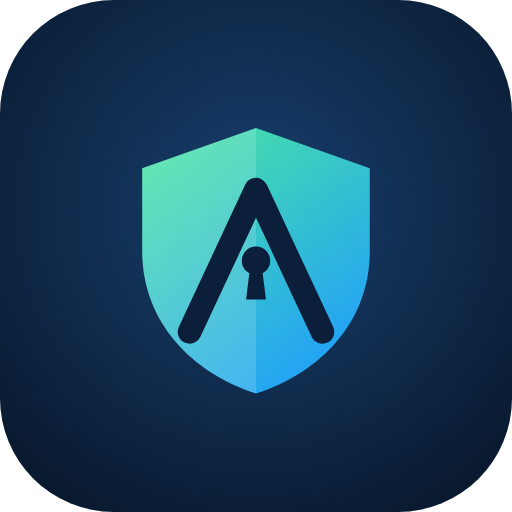

# Alexia Shield

Lokálna Android appka na ochranu súkromia. Funguje bez rootu a bez servera, všetko beží v telefóne.

## Moduly
| Záložka | Čo robí | Kód |
|---|---|---|
| Prehľad | Skóre ochrany telefónu a stav všetkých ochrán | `ui/screens/OverviewScreen.kt` |
| Appky | Privacy Score A–F: oprávnenia × typ appky, prístupnosť, sideload, trackery v DEX | `audit/` |
| Antivírus | Detektor bankových trójskych koní (offline) + kontrola SHA-256 appiek v databáze MalwareBazaar, denne aj na pozadí | `audit/BankerDetector.kt`, `audit/MalwareChecker.kt` |
| Odkazy | Varovanie pred podvodnými odkazmi v notifikáciách (SMS, WhatsApp…) + ručná kontrola | `linkscan/` |
| Firewall | Lokálna VPN: filtrovanie DNS alebo odrezanie internetu vybraným appkám | `firewall/` |
| Senzory | Výstraha, keď sa kamera alebo mikrofón zapnú pri zamknutom telefóne | `sensors/` |

## Spustenie
1. Rozbaľ ZIP a otvor priečinok `AlexiaShield` v Android Studiu (Ladybug alebo novšie).
2. Počkaj na Gradle sync (AGP 8.7.3, Kotlin 2.1, Gradle 8.11.1, compileSdk 35, minSdk 26).
3. Spusti na telefóne s Androidom 8+.

## Povolenia, ktoré používateľ zapne ručne
- **Prístup k notifikáciám**: kontrola odkazov
- **Prístup k využitiu**: presnejší audit a odhad appky pri kamere/mikrofóne
- **VPN súhlas**: pri prvom zapnutí firewallu
- **Kľúč MalwareBazaar** (voliteľné, zdarma na https://auth.abuse.ch/): kontrola podľa databázy malvéru

## Obmedzenia
- Súkromné DNS v Androide a appky s vlastným DoH obídu DNS filter.
- Naraz môže bežať iba jedna VPN.
- Android neprezradí, ktorá appka používa kameru/mikrofón, iba to, že sa používajú.
- Na Google Play treba zdôvodniť `QUERY_ALL_PACKAGES` a foreground službu `specialUse`.

## Ďalšie kroky
- Room DB namiesto JSON denníka
- Google Safe Browsing ako voliteľná online kontrola odkazov
- Widget so skóre
- Vlastný allowlist domén
